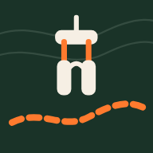
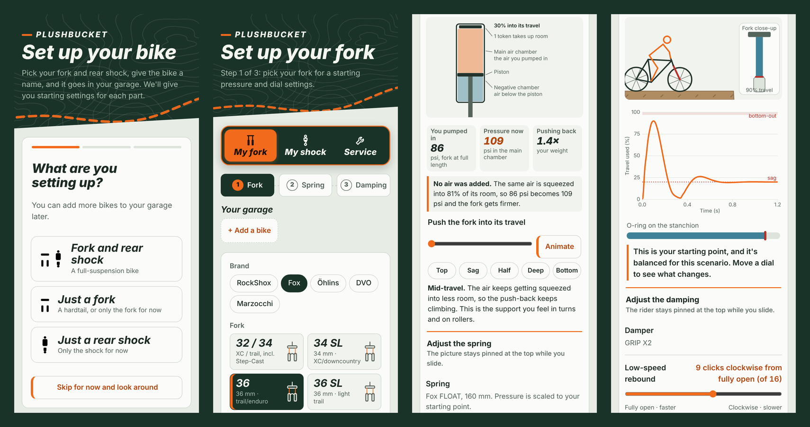

  

<h1 align="center">Plushbucket</h1>

  <b>Measured in the lab, tested on the trail.</b> 
  Mountain bike suspension setup that shows you why. 
  Starting pressures, sag and dial settings for your fork and rear shock, from the makers' own charts.

  <a href="https://plushbucket.com"><b>plushbucket.com</b></a>

  

## What it does

Pick your fork and rear shock, enter your weight, and Plushbucket gives you a starting point you can take to the trailhead:

- **Air pressure or spring rate**, from the manufacturer's chart for your exact model, year and travel
- **Sag target** in millimeters: 20% of travel for forks, 30% of stroke for rear shocks
- **Rebound and compression clicks**, always written as "turn fully counterclockwise (open), then N clicks clockwise"
- **Tokens and volume spacers**: stock count and the maximum for your travel

Then it teaches you what those numbers do:

- **Spring:** an animated cutaway of the air spring and a force curve, so you can see how pressure, tokens and negative spacers change the feel through the travel
- **Damping:** a rider-and-bike simulator for roots, drops, braking and pedaling, so you can watch what each dial does before you touch it
- **Tune it on the trail:** what to change for fast and chunky terrain, steep chutes, drops and flat landings
- **Something feels wrong?** Symptom-based fixes, such as harsh on square edges, bucks after landings or dives under braking
- **Service log:** track ride hours and see when each part is due for service

## Supported suspension

| Brand | Forks | Rear shocks |
|---|---|---|
| **Fox** | 32 / 34 (incl. Step-Cast), 34 SL, 36, 36 SL, 38, Podium, 40 | FLOAT X2, FLOAT X, FLOAT SL, FLOAT, DHX2, DHX |
| **RockShox** | SID, SID SL, Pike, Lyrik, ZEB, BoXXer | Super Deluxe, Vivid Air, Vivid / Super Deluxe Coil, Deluxe / SIDLuxe |
| **Marzocchi** | Bomber Z1, Bomber Z2, Super Z, Bomber 58 | Bomber Air, Bomber CR |
| **Öhlins** | RXF36, RXF38 | TTX1Air, TTX2Air, TTX22m.2 |
| **DVO** | Diamond, Diamond 36, Onyx 38 | Topaz Prime, Topaz T3 Air, Jade X |

Coverage varies by model year. Where a manufacturer doesn't publish a number, the app says so instead of guessing.

## Where the numbers come from

Every pressure chart, click count, token limit and maximum pressure comes from the manufacturer's owner's manuals, spec sheets and setup guides, such as Fox's Bike Tech Help Center and RockShox's specification documents. Each one is checked against the source before it ships. When sources disagree, the app follows the maker's limit and explains the conflict in a note.

These settings are a starting point. Always stay within the maximum pressure printed on your fork or shock, and follow your frame maker's guidance where it differs.

## Install it on your phone

Plushbucket is an installable web app that works offline once it's loaded.

- **iPhone (Safari):** open plushbucket.com, tap **Share**, then **Add to Home Screen**
- **Android (Chrome):** open plushbucket.com and tap **Install** in the bar at the bottom, or use the menu and choose **Install app**

## Project files

| File | What it is |
|---|---|
| `index.html` | The whole app: data, simulator and interface in a single file |
| `sw.js` | Service worker for offline use and updates |
| `manifest.webmanifest` | App name, colors and icons for installing |
| `_headers` | Netlify caching headers |
| `icons/` | App and home-screen icons |

Hosted on Netlify. Every commit to `main` deploys to plushbucket.com.

## Feedback

Spotted a wrong number or want your fork added? [Open an issue](../../issues) with the model, year and a link to the manufacturer's document.

## License

© 2026 Plushbucket. All rights reserved.
